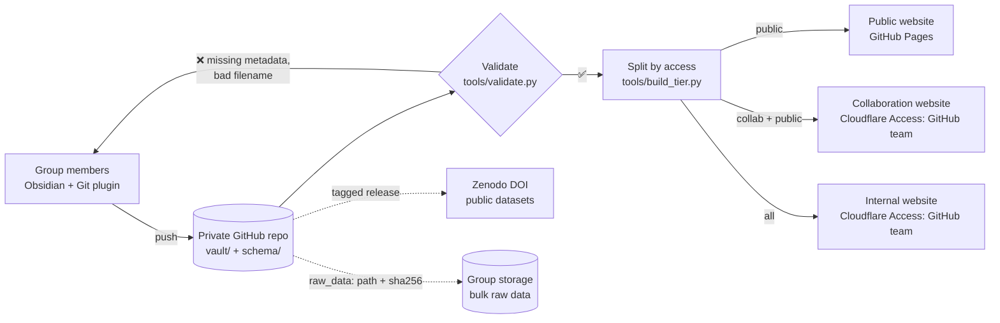

# Group Lab Archive: Obsidian + GitHub demo

A working proposal for the group's archival system: **one Obsidian vault, version-controlled on GitHub, automatically published as three websites with different access levels.**

> **All data, drawings and results in this repository are synthetic** (`tools/demo/generate_synthetic_data.py`). The people and projects provide realistic context. The structure is the proposal.

| Audience | Demo site | In production |
| --- | --- | --- |
| Public | **https://msekatchev.github.io/group-archive-demo/** | GitHub Pages |
| Collaboration | https://msekatchev.github.io/group-archive-demo/collab/ | behind "Sign in with GitHub" |
| Group-internal | https://msekatchev.github.io/group-archive-demo/internal/ | behind "Sign in with GitHub" |

Every page has an audience switcher at the top. Open the same record in each tier to compare.

---

## The problem (Karl's four questions)

| Question | This proposal |
| --- | --- |
| **1. What system?** | Obsidian (free, plain Markdown files) + GitHub (free for education). No vendor lock-in: the archive is a folder of text files that will open in any editor in 30 years. |
| **2. What goes in?** | Everything, as **records**: measurements, simulations, CAD, analyses, memos, meetings and viewgraphs, publications, public datasets. Raw bulk data stays on group storage with a checksum in the record. Data underlying papers is deposited to Zenodo/Dryad with a DOI, which meets the federal public-access requirement. |
| **3. Indexing + 2–3 levels of security** | Structured metadata on every record, with live catalogs (Obsidian Bases) and static catalogs on the web. Three tiers (`internal` / `collaboration` / `public`), each managed through **GitHub accounts and teams**. |
| **4. Descriptive filenames, CAD versions, measurement conditions** | Every file starts with its record ID. CAD revisions are lettered and never overwritten. **Required conditions per measurement type** (a bead-pull without rod angle, bead, CAD revision and VNA settings is rejected automatically). |

## How it works



- **Access control comes from GitHub accounts.** Group members are a GitHub Team with write access to the private repo. Collaborators are a second team with read access. The two restricted websites sit behind Cloudflare Access (free for up to 50 users), which logs people in with GitHub and checks team membership. Removing someone from the team revokes everything.
- **Why not just private GitHub Pages?** Pages sites are public unless the organization has GitHub Enterprise Cloud. If the university offers Enterprise Cloud, the restricted tiers could live there instead.
- **Nothing is published by accident.** A note without an `access` tag is internal. Links from a public page to an internal record are shown as `🔒 RECORD-ID`, so titles and content never leak. Storage paths are removed outside the internal site.

## A 5-minute demo

1. **Public site → [CAV-02](https://msekatchev.github.io/group-archive-demo/Apparatus/CAV-02-Tunable-copper-cavity).** Logbook, parts, and the backlinks panel: every measurement on this cavity, with nobody maintaining the list.
2. **[MEAS-2026-015, bead-pull at 112°](https://msekatchev.github.io/group-archive-demo/Measurements/2026/MEAS-2026-015-CAV-02-bead-pull-at-112-deg/MEAS-2026-015-CAV-02-bead-pull-at-112-deg).** Open *Record metadata*: rod angle, bead, VNA power and IF bandwidth, CAD revision, operator, raw-data checksum. Note that the CAD and memo links are 🔒 on the public site.
3. **Switch the audience to Collaboration.** The CAD drawing and the tech memo appear. Switch to **Group-internal**: GALAXIS, meeting notes, the paper draft and storage paths appear.
4. **[LEGACY-2019-002](https://msekatchev.github.io/group-archive-demo/internal/Measurements/Legacy/LEGACY-2019-002-PBG-01-mode-map-%28recovered%29/LEGACY-2019-002-PBG-01-mode-map-%28recovered%29)** (internal): what we have today: `final_FINAL2.xlsx`, columns `col1, col2, col3`, conditions unknown.
5. **On GitHub**, open [`CAD-CAV02-001_barrel_revC.stl`](vault/CAD/CAD-CAV02-001%20Cavity%20barrel/CAD-CAV02-001_barrel_revC.stl) and rotate the 3D model. Open the [commit history](../../commits/main) to see who changed what and when.
6. **Open pull request "Example: incomplete bead-pull record"** to see the validator rejecting a record with a missing rod angle and a badly named file.
7. **[DATA-2026-001](https://msekatchev.github.io/group-archive-demo/Datasets/DATA-2026-001-CAV-02-tuning-characterization).** The public data-release page, with license, DOI (placeholder) and the records it contains.
8. **In Obsidian** (clone, open `vault/`): graph view, the Catalog as live Bases tables, and new records from templates.

## Repository layout

```
vault/                 ← open this folder in Obsidian
  index.md             archive home
  Catalogs/            Obsidian Bases (live tables) + Catalog page
  Apparatus/           one note per piece of hardware, with logbook
  Measurements/2026/   one folder per measurement: note + processed data + plots
  Measurements/Legacy/ rescued old data, archived as found
  Simulations/  CAD/  Analyses/  Memos/  Meetings/  Publications/  Datasets/
  Procedures/          versioned measurement procedures
  People/  Projects/
  Archive Policy/      access tiers, naming, required metadata, data sharing, storage, how-to
  Templates/           record templates (not published)
schema/record-types.yaml   required fields per record type; the single definition of "complete"
tools/validate.py          enforces the schema, naming and links (runs on every push)
tools/build_tier.py        builds the content each audience may see
tools/build_site.sh        validate → split → render the three sites with Quartz
site/                      Quartz configuration
.github/workflows/         validate.yml · pages.yml · cloudflare-restricted.yml
```

## Using it locally

```bash
python3 -m pip install pyyaml
python3 tools/validate.py          # check the vault
tools/build_site.sh                # build _site/ (needs Node 22; fetches Quartz v4.5.2 on first run)
```

Then open `vault/` in Obsidian and enable the bundled Git plugin. It pulls on start-up and commits and pushes every 10 minutes.

## Comparison

| | Obsidian + GitHub | LabArchives | Google Drive |
| --- | --- | --- | --- |
| Cost | Free (education); storage extra | Per-seat license (check whether campus already has one) | Included, but campus quotas apply |
| File format | Plain Markdown, any editor, forever | Proprietary; export to PDF/HTML | Native files |
| Required metadata per experiment type | Enforced automatically | Templates, not enforced | None |
| Full history, who changed what | Git, line by line | Yes | Per-file versions |
| Access tiers | GitHub teams + login gate | Yes, built in | Yes, per folder |
| Public data release with DOI | Zenodo–GitHub integration | Manual | Manual |
| Survives people leaving | Repo owned by group org | Yes | No: files vanish with departed accounts unless moved |
| Large raw data | No: pointer + checksum to storage | Limited | Yes |
| Learning curve | Moderate (Git plugin hides most of it) | Low | Lowest |

**Main risks:** Git is unfamiliar to some people (mitigated by the Obsidian Git plugin, GitHub Desktop, or emailing files to the coordinator). Someone has to own the schema and the yearly audit. Bulk storage is still a separate decision.

## Moving from demo to production

1. Create a GitHub **organization** for the group (free via GitHub Education). Make teams `group` (write) and `collaborators` (read).
2. Move this repo into the org as **private**. In `pages.yml`, set `TIERS: public`.
3. Cloudflare (free): create Pages projects `<name>-collaboration` and `<name>-internal`. Add a GitHub login method and an Access policy per site requiring the matching GitHub team. Set the repository variable `CLOUDFLARE_PAGES_PROJECT` and the secrets `CLOUDFLARE_API_TOKEN` / `CLOUDFLARE_ACCOUNT_ID`.
4. Connect the repo to Zenodo for DOI-on-release.
5. Decide on bulk storage. Pilot on one project for a month, then backfill old work as `LEGACY-` records.
