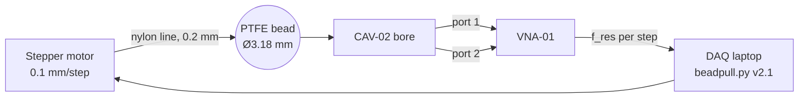

# BPR-01 Bead-pull rig

A stepper-driven fishing-line stage that pulls a dielectric bead along the cavity axis while the [[VNA-01 Vector network analyzer]] tracks the resonant frequency. Operating procedure: [[PROC-001 Bead-pull measurement]].

## Bead inventory

| Bead | Material | Diameter | Use |
| --- | --- | --- | --- |
| B-PTFE-3 | PTFE | 3.18 mm | E-field, default |
| B-AL-3 | aluminum | 3.18 mm | E + H field |
| B-PTFE-6 | PTFE | 6.35 mm | low-signal modes |
