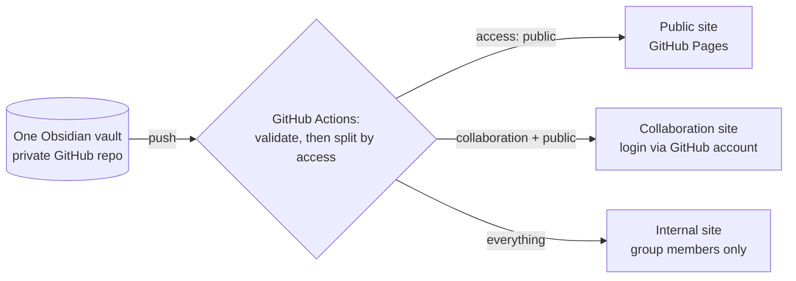

# POL-001 Access tiers

Every note has an `access` property with one of three values. **If it is missing, the note is treated as `internal`**, so nothing is published by accident.

| `access` | Who can see it | Where |
| --- | --- | --- |
| `internal` | Group members | Private GitHub repo + Obsidian; internal website |
| `collaboration` | Group + named collaborators | Collaboration website (login required) |
| `public` | Anyone | Public website + DOI-backed data deposits |

Each level includes the levels below it: group members see everything, and collaborators see collaboration and public notes.

## How it's enforced

1. **Source of truth:** a *private* GitHub repository. Write access goes only to group members (a GitHub Team), and every change is attributed and reversible.
2. **Build:** on every push, `tools/build_tier.py` makes one copy of the vault per audience. Notes above that audience's level are dropped. Attachments go with the record note in their folder. **Links to dropped notes become 🔒 plus the record ID**, so the title and content never appear. Fields such as `raw_data` and `storage_path` are removed outside the internal site.
3. **Hosting:**
   - *Public:* GitHub Pages.
   - *Collaboration and internal:* a static host behind an identity gate. The proposal is Cloudflare Pages + Cloudflare Access, which is free for up to 50 users. Its login option is **"Sign in with GitHub"**, and the rule is **"member of GitHub team `our-group/collaborators`"**, so access is managed in one place: GitHub team membership.
   - Collaborators who want the files themselves can be given **read-only** access to the private repo.

## Why not a single private GitHub Pages site?
GitHub Pages sites are public, even when built from a private repo. The only exception is GitHub Enterprise Cloud, which can restrict a site to members of the organization. If the university provides Enterprise Cloud, the internal tier could use it directly. Ask Research IT.

## Simpler fallback
A shared password for the collaboration site (e.g. with client-side encryption tools such as StatiCrypt). Easier to set up, but weaker: there is no per-person access or revocation, and passwords get forwarded.

## In this demo
The demo repo is public, so all three tiers are published side by side at `/`, `/collab/` and `/internal/` to show the difference. Use the audience switcher at the top of each page. In production the last two would sit behind the login gate.
